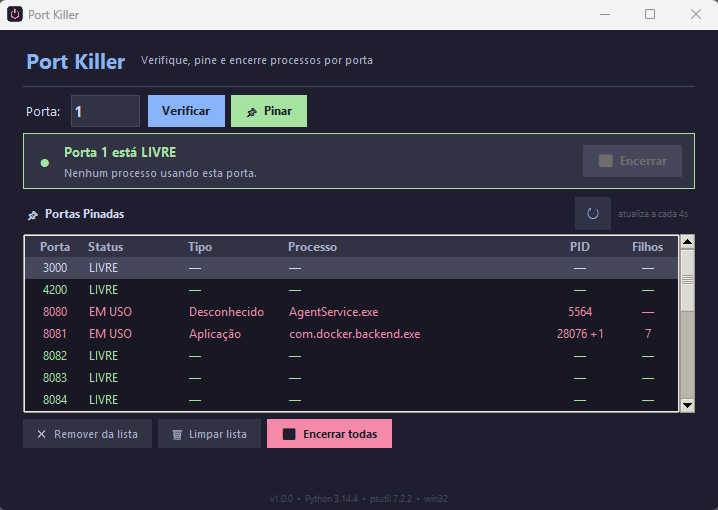

# 🔌 Port Killer

Utilitário desktop para **verificar e encerrar processos** que estão ocupando uma porta de rede — com interface gráfica moderna e suporte a **Windows** e **Linux**.

Desenvolvido com **Python 3** e **tkinter**, usando **psutil** para inspeção de processos e conexões em tempo real.

<p align="center">
  <a href="https://github.com/holandale0/port-killer/blob/main/LICENSE">
    
  </a>
</p>

---

## 📸 Screenshot



---

## ✨ Funcionalidades

- Verifica qual processo está usando uma porta específica (1–65535)
- Exibe **PID**, **nome do processo**, **status**, **tipo de processo** e **quantidade de processos filhos** em tempo real
- **Tipo de processo** identificado automaticamente: `Sistema`, `Aplicação` ou `Desconhecido`
- **Lista de portas pinadas** — persiste entre sessões (salvo em arquivo JSON local)
- **Auto-refresh** da lista a cada 4 segundos
- Status detalhado por porta: `EM USO`, `LIVRE`, `DORMINDO`, `PARADO`, `ZUMBI`, `AGUARD. E/S`
- Encerra processo individual via botão ou duplo clique na lista
- **Encerrar todas** — encerra de uma vez todos os processos com status diferente de `LIVRE`
- Confirmação obrigatória em **todo** encerramento; senha sudo opcional no Linux (necessária apenas para processos de outro usuário)
- Interface **dark mode** com tema [Catppuccin Mocha](https://github.com/catppuccin/catppuccin)
- Gera seu próprio instalador com um único comando — o executável final **não precisa de Python instalado**

---

## 🚨 Riscos de encerrar um processo

> [!CAUTION]
> **Encerrar um processo é uma ação irreversível.** Use esta ferramenta com consciência. Em ambientes que não sejam de desenvolvimento local, as consequências podem ser graves e difíceis de reverter.

| Cenário | Seguro? |
|---|---|
| Servidor de desenvolvimento local travado | ✅ Sim |
| Processo desconhecido em porta inesperada | ⚠️ Verifique antes |
| Banco de dados com aplicações conectadas | ❌ Risco de perda de dados |
| Serviços do sistema operacional | ❌ Risco de instabilidade |
| Qualquer processo em produção | ❌ Não recomendado |

**Perda de dados** — Processos de banco de dados, editores e servidores de arquivo mortos abruptamente não têm chance de salvar estado ou fechar transações. Resultado: arquivos corrompidos, registros inconsistentes ou necessidade de recovery manual.

**Queda em cascata** — Serviços que dependem do processo encerrado também falham. Matar um banco de dados derruba todas as aplicações conectadas. Matar um servidor de autenticação pode bloquear o acesso a todo um sistema.

**Serviços críticos do SO** — Matar processos como DNS, firewall, antivírus ou agentes de segurança pode desestabilizar o sistema ou abrir brechas de segurança até a próxima reinicialização.

**Árvore de processos** — O app encerra o processo **e todos os seus descendentes**. É isso que libera de fato a porta em casos como `npm`/`node`, mas amplia o alcance da ação: confira a coluna **Filhos** antes de confirmar — o dialog mostra quantos descendentes serão atingidos.

**Encerramento forçado (SIGKILL)** — Cada processo recebe SIGTERM e tem 1,5 s para sair limpo. Quem não sair leva SIGKILL — uma finalização forçada que o processo não pode capturar, ignorar ou tratar. Nenhum dado em memória é salvo.

**Ambientes de produção** — Nunca use esta ferramenta em servidores de produção sem antes entender exatamente o que o processo faz. Interromper um servidor web ativo encerra imediatamente todas as sessões de usuários conectados.

---

## 🧰 Tecnologias

| Tecnologia | Versão | Uso |
|---|---|---|
| Python | 3.10+ | Linguagem principal |
| tkinter | built-in | Interface gráfica |
| psutil | ≥ 5.9.0 | Inspeção de processos e conexões de rede |
| PyInstaller | ≥ 6.0 | Empacotamento do executável standalone |
| Inno Setup | 6.3+ | Criação do instalador Windows (.exe) |

---

## 💻 Instalação

O Port Killer não distribui instaladores prontos: você gera o seu a partir do
código-fonte. O script `build.py` faz todo o trabalho — cria um ambiente
virtual isolado, instala as dependências, empacota o Python e o psutil num
executável standalone com o PyInstaller e monta o instalador nativo.

> Cada plataforma precisa ser compilada nela mesma: o PyInstaller não gera
> executáveis para outro sistema operacional.

### 🪟 Windows 10 / 11

**1. Instale os pré-requisitos**

| Ferramenta | Para quê | Onde obter |
|---|---|---|
| [Python 3.10+](https://www.python.org/downloads/) | Executar o build | Instalador oficial — o tkinter já vem incluso |
| [Git](https://git-scm.com/download/win) | Baixar o código | Instalador oficial |
| [Inno Setup 6.3+](https://jrsoftware.org/isdl.php) | Gerar o instalador `.exe` | Instalador oficial, no caminho padrão |

**2. Baixe o código e gere o instalador**

```powershell
git clone https://github.com/holandale0/port-killer.git
cd port-killer
python build.py
```

O instalador é gerado em `installer\windows\Output\PortKiller_Setup_<versão>.exe`.

**3. Instale**

Execute o `.exe` gerado e confirme o pedido de Administrador (UAC). O Port
Killer é instalado em `C:\Program Files\Port Killer`, com atalho no Menu
Iniciar e, opcionalmente, na Área de Trabalho. Para atualizar, gere um
instalador novo e execute-o por cima da versão anterior.

> Sem o Inno Setup, o build entrega só o executável standalone
> `dist\PortKiller.exe`, que pode ser usado sem instalar.

### 🐧 Linux (x86_64)

**1. Instale os pré-requisitos** (exemplo para Ubuntu/Debian)

```bash
sudo apt install git python3 python3-tk python3-venv libfuse2
```

Em versões recentes do Ubuntu o pacote `libfuse2` se chama `libfuse2t64`.

**2. Instale o appimagetool**, que monta o arquivo `.AppImage`:

```bash
curl -L -o appimagetool https://github.com/AppImage/AppImageKit/releases/download/continuous/appimagetool-x86_64.AppImage
chmod +x appimagetool
sudo mv appimagetool /usr/local/bin/
```

**3. Baixe o código e gere o AppImage**

```bash
git clone https://github.com/holandale0/port-killer.git
cd port-killer
python3 build.py
```

O AppImage é gerado em `dist/PortKiller-<versão>-x86_64.AppImage`.

**4. Execute**

```bash
chmod +x dist/PortKiller-*-x86_64.AppImage
./dist/PortKiller-*-x86_64.AppImage
```

O AppImage é um arquivo único e não precisa de instalação: mova-o para onde
preferir (por exemplo, `~/Applications`).

> Sem o appimagetool, o build entrega só o binário standalone `dist/PortKiller`.

### Executar direto pelo código-fonte

Para usar sem gerar instalador (requer Python 3.10+ com tkinter):

```bash
git clone https://github.com/holandale0/port-killer.git
cd port-killer
pip install -r requirements.txt
python port_killer.py
```

No Linux, use um ambiente virtual (`python3 -m venv .venv && . .venv/bin/activate`)
antes do `pip install`.

### Limpar os artefatos de build

```bash
python build.py --clean
```

Mais detalhes sobre o processo de build em [BUILD.md](BUILD.md).

---

## 🧪 Testes

```bash
python -m unittest discover -s tests -v
```

Sem dependências extras. Os testes de interface se pulam sozinhos quando não há
Tk/display disponível. O CI roda a suíte (Python 3.10 e 3.13) e compila os
instaladores a cada push.

---

## ⚠️ Permissões

Em alguns sistemas pode ser necessário executar como **Administrador** (Windows) ou com **sudo** (Linux) para visualizar processos de sistema ou encerrar processos privilegiados.

- **Windows** — ao encontrar um processo sem permissão, o app oferece reabrir a si mesmo como Administrador (UAC).
- **Linux** — o dialog de confirmação tem um campo de senha sudo **opcional**, usado apenas se o encerramento normal for negado.

Processos cujo dono não pode ser lido aparecem como `Desconhecido` — nunca como `Aplicação`.

---

## ✅ Checklist

- [x] Verificação de porta em tempo real
- [x] Exibição de PID, nome, status e processos filhos
- [x] Identificação do tipo de processo (Sistema, Aplicação, Desconhecido)
- [x] Encerramento de processo individual com confirmação
- [x] Lista de portas pinadas com persistência entre sessões
- [x] Auto-refresh da lista a cada 4 segundos
- [x] Status detalhado: EM USO, LIVRE, DORMINDO, PARADO, ZUMBI etc.
- [x] Encerrar processo por duplo clique na lista
- [x] Encerrar todas as portas com status diferente de LIVRE
- [x] Dialog de confirmação com senha sudo opcional (Linux)
- [x] Encerramento da árvore de processos (pai + descendentes)
- [x] Detecção de múltiplos processos na mesma porta (SO_REUSEPORT, dual-stack)
- [x] Limpar lista pinada
- [x] Interface dark mode (Catppuccin Mocha)
- [x] Instalador Windows com wizard (Inno Setup)
- [x] AppImage para Linux
- [x] Script de build automatizado (`build.py`)
- [x] Ícones próprios (`.png`, `.ico`) no Windows e no Linux
- [x] Relaunch com elevação UAC no Windows
- [x] Suíte de testes (`python -m unittest discover -s tests`)
- [x] CI com GitHub Actions
